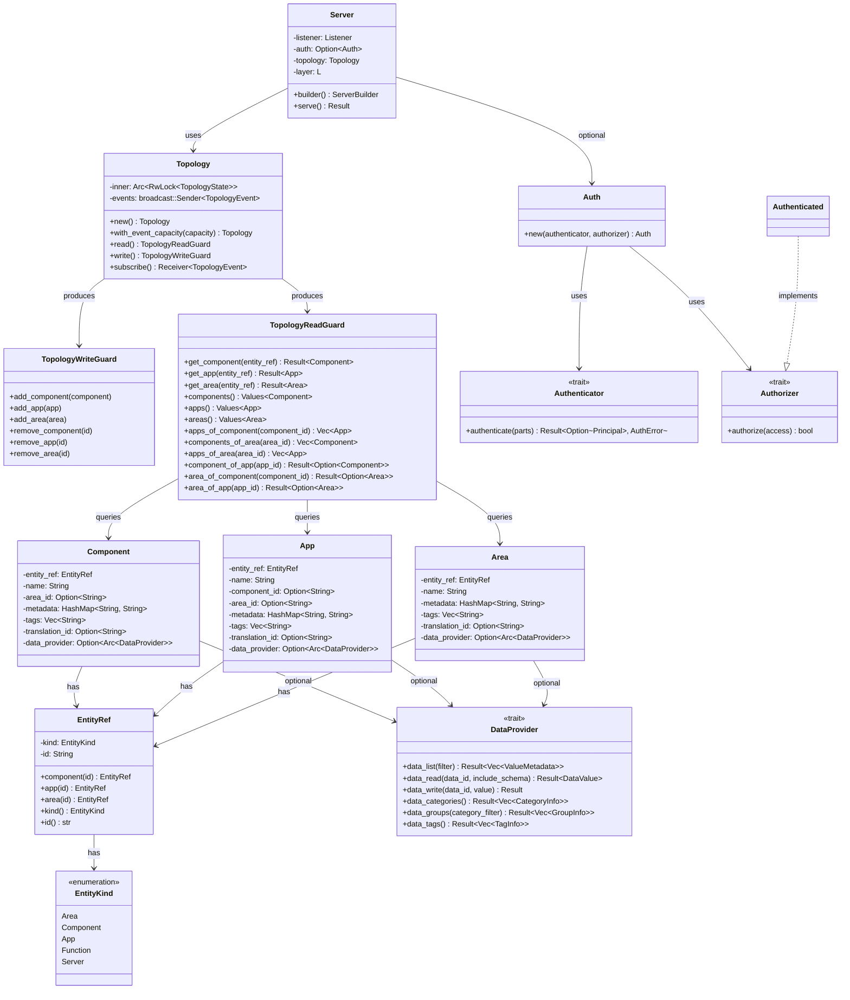
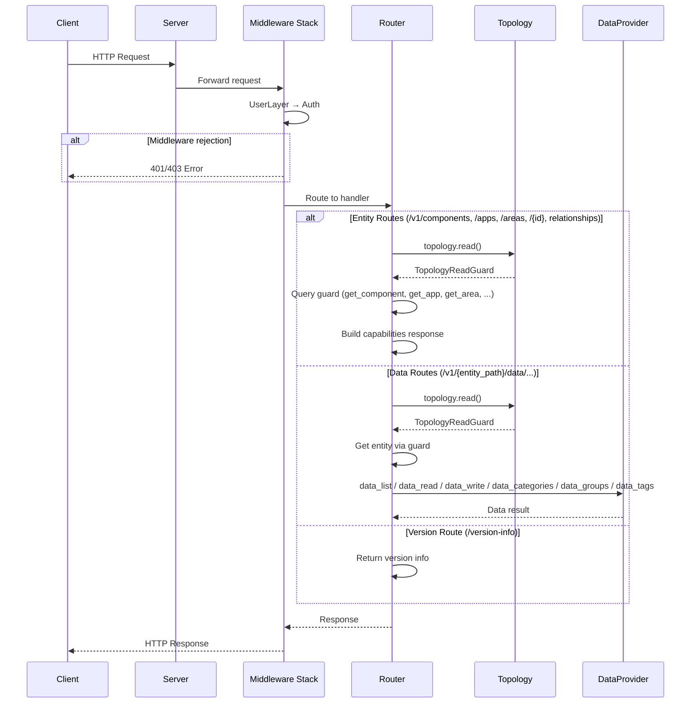

# Architecture

## Class Diagram

## Main Components

### Server

The main entry point for the OpenSOVD application. Built using a builder pattern that allows configuring authentication, authorization, topology, and custom Tower layers. Supports both TCP and Unix socket listeners. On `serve()`, it starts the Axum HTTP server with graceful shutdown.

**Crate:** `opensovd-server`

### Topology

A thread-safe registry for components, apps, and areas. Wraps an `Arc<RwLock<TopologyState>>` where the state holds three `IndexMap` collections (one per entity kind) plus relationship indexes (`apps_by_component`, `components_by_area`, `apps_by_area`). Reading is done through `read()` which returns a `TopologyReadGuard` holding a single read lock for consistent multi-query access. Mutations are done through `write()` which returns a `TopologyWriteGuard` holding a single write lock; `add_*` overwrites an existing entry with the same ID and `remove_*` silently skips missing IDs. `TopologyEvent::Added` / `TopologyEvent::Removed` events are batched on the guard and flushed via a `broadcast` channel when the guard is dropped. Callers can `subscribe()` to receive these events.

**Crate:** `opensovd-core`

### TopologyReadGuard

A read guard over the topology state. Holds a `RwLockReadGuard` for its lifetime, ensuring a consistent snapshot across multiple queries. Provides `get_component()`, `get_app()`, `get_area()` for single-entity lookup, `components()`, `apps()`, `areas()` for listing, and relationship queries: `apps_of_component()`, `components_of_area()`, `apps_of_area()`, `component_of_app()`, `area_of_component()`, `area_of_app()`.

**Crate:** `opensovd-core`

### TopologyWriteGuard

A write guard over the topology state. Holds a `RwLockWriteGuard` for its lifetime so a batch of mutations applies atomically. Provides `add_component()`, `add_app()`, `add_area()` (each overwrites an existing entry with the same ID) and `remove_component()`, `remove_app()`, `remove_area()` (each silently skips missing IDs). Topology events are accumulated in the guard and flushed to the broadcast channel when the guard is dropped.

**Crate:** `opensovd-core`

### EntityRef / EntityKind / EntityPath

`EntityKind` is an enum with variants `Area`, `Component`, `App`, `Function`, and `Server`. `EntityRef` is a lightweight reference containing a `kind` and `id`. Factory methods `EntityRef::component()`, `EntityRef::app()`, and `EntityRef::area()` create refs. All entity structs hold an `EntityRef` and expose it via `entity_ref()`.

`EntityPath` names an entity by its kind and its ids from the top level down, and displays percent-encoded, such as `components/Cabin/subcomponents/Display`. `EntityPath::area()`, `component()`, `app()`, `function()` and `server()` build one, `child()` nests an area or a component one level, and an empty, `.` or `..` id is rejected. The server builds one for the entity a route addresses.

**Crate:** `opensovd-core`

### Component

A SOVD component entity. Fields: `entity_ref`, `name`, `area_id` (optional link to an area), `metadata` (key-value pairs), `tags`, `translation_id`, and an optional `Arc<dyn DataProvider>`. Constructed via `Component::new(id, name)` with builder methods (`with_area_id`, `with_tags`, `with_metadata`, `with_data_provider`, etc.).

**Crate:** `opensovd-core`

### App

A SOVD app entity representing software running on a component. Fields: `entity_ref`, `name`, `component_id` (optional, the "is-located-on" relationship), `area_id` (optional), `metadata`, `tags`, `translation_id`, and an optional `Arc<dyn DataProvider>`. Constructed via `App::new(id, name)` with builder methods such as `with_component_id`.

**Crate:** `opensovd-core`

### Area

A SOVD area entity representing a logical view of vehicle architecture (e.g., domain or zone). Fields: `entity_ref`, `name`, `metadata`, `tags`, `translation_id`, and an optional `Arc<dyn DataProvider>`. Constructed via `Area::new(id, name)` with builder methods.

**Crate:** `opensovd-core`

### DataProvider (trait)

A pluggable data backend. Each entity holds its own provider instance, so methods operate on the provider directly without an entity reference:

- `data_list(filter: DataFilter) → Vec<ValueMetadata>` — list data items, filtered by categories/groups/tags
- `data_read(data_id, include_schema) → DataValue` — read a single data value
- `data_write(data_id, value) → ()` — write a data value

Default implementations derive from `data_list()`:

- `data_categories() → Vec<CategoryInfo>` — unique categories
- `data_groups(category_filter) → Vec<GroupInfo>` — groups optionally filtered by category
- `data_tags() → Vec<TagInfo>` — unique tags

**Crate:** `opensovd-core`

### Authenticator (trait)

Validates the credentials of a request and returns the caller as a `Principal`, `Ok(None)` when the request carries none, or `Err(AuthError::InvalidToken)` when they are rejected.

**Crate:** `opensovd-server`

### Authorizer (trait)

Decides whether a request may proceed from its `Access`: the method, the template (relative to the mount path) and decoded parameters of the matched route, and the principal if any. `Authenticated` allows every authenticated caller.

**Crate:** `opensovd-server`

## Request Lifecycle

The following diagram shows how an HTTP request flows through the server: from the middleware stack (authentication and authorization) to the router, which dispatches to entity, data, or version handlers.

### Middleware Stack

Every request passes through the middleware stack in this order:

1. **User layers** (CORS, tracing, etc.) — applied outermost via the configurable `Layer` generic.
2. **`Auth`** — runs after routing on every route and the fallback. It authenticates the request, then asks the authorizer. A denied request without a principal gets **401** with an empty body and a `WWW-Authenticate: Bearer` challenge; with a principal it gets **403** and a JSON `GenericError` body containing the `insufficient-access-rights` error code. Rejected credentials get **401** regardless of the policy.

If the request is allowed, the principal is stored in the request extensions and the request is forwarded to the matched route handler.

### Entity Routes

`GET /{entity_collection}` (e.g., `/components`, `/apps`, `/areas`) acquires a read lock via `topology.read()` → `TopologyReadGuard`, iterates/filters the matching entities, and returns a JSON array of `EntityReference` objects. `GET /{entity_collection}/{id}` looks up a single entity and returns its capabilities, including relationship hrefs and data provider availability. Returns **404** if the entity is not found.

The route table in `routes/mod.rs` has one router per entity kind. It says what the kind serves, relative to the entity: the area, component and app listings on the server, resource collections on components and apps, `contains` on areas and `hosts` on components.
`versioned()` mounts each router where it is served, such as `/components/{component_id}`. Handlers take the entity from the `Entity` extractor, which reads it from the route's entity params. A method the route does not serve answers **405** with the `method-not-allowed` vendor code and an `Allow` header. Any other path answers **404** `resource-not-found`. A path param that is not UTF-8 answers **400** `incomplete-request`, and an empty, `.` or `..` entity id **404** `resource-not-found`.

A request is checked in this order:

- the route first: an unknown path answers **404** `resource-not-found`, a method the route does not serve **405** `method-not-allowed`;
- then the request's form: path params, query, headers and body (**400**, **415**);
- then the entity (**404** `entity-not-found`);
- then the resource (**404** `resource-not-found`);
- then the operation.

### Data Routes

`GET /{entity_path}/data/{data_id}` acquires a read lock, takes the entity from the route, fetches it from the `TopologyReadGuard`, extracts its `DataProvider`, and calls `data_read()`. `PUT` follows the same lookup but calls `data_write()` instead. Returns **404** if the entity, its data provider or the data item is not found, **405** with `Allow: GET` if a write is attempted on a read-only item, **405** with `Allow: PUT` if a read is attempted on a write-only item, **400** with a `DataError` body if the request body is malformed or the value does not fit the item, and **204 No Content** on a successful write.

### Version Route

`GET /version-info` returns the SOVD specification version, base URI, and optional vendor-specific information. This route does not access the topology.
