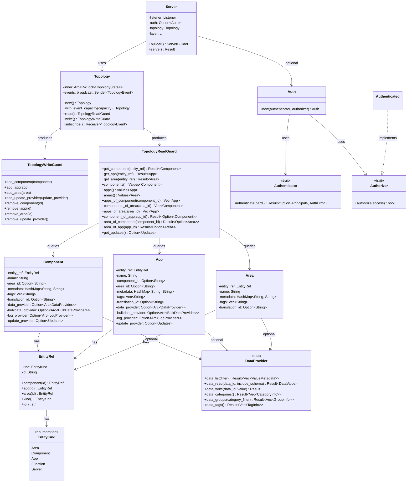
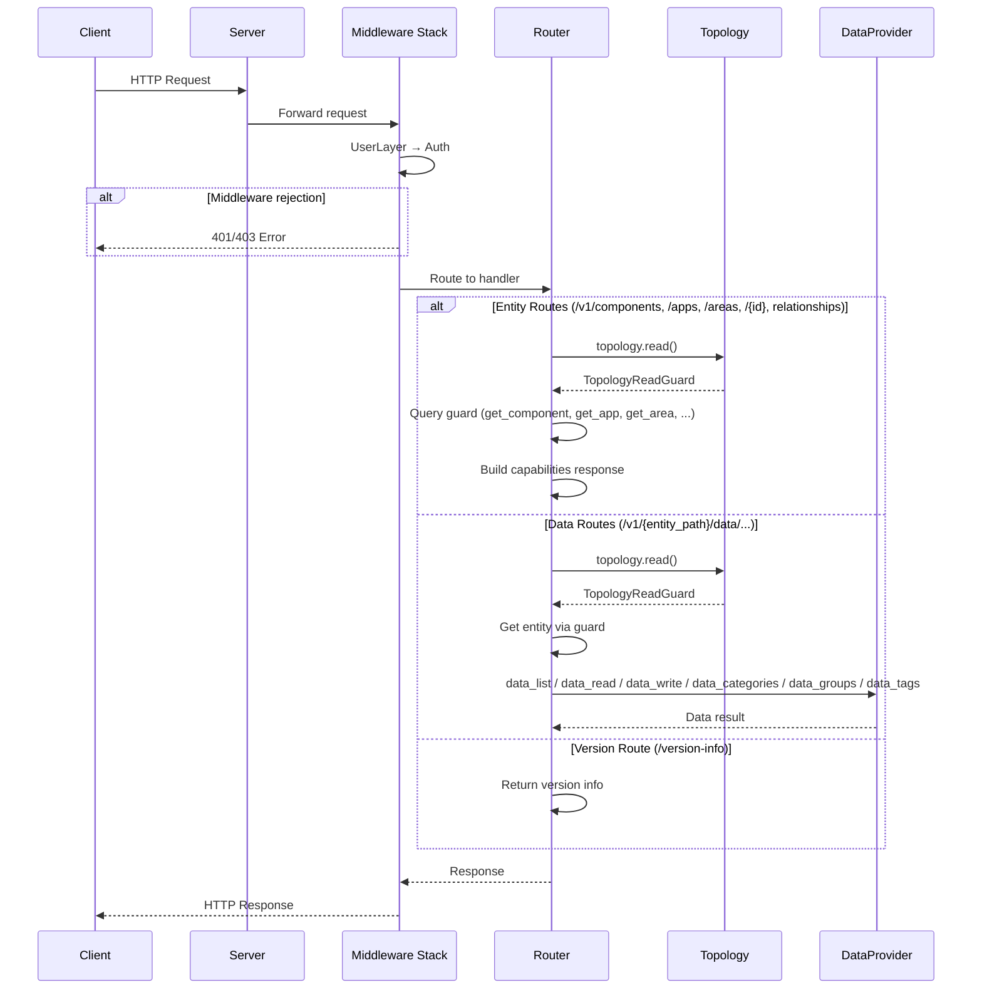

# Architecture

## Class Diagram

## Main Components

### Server

The main entry point for the OpenSOVD application. Built using a builder pattern that allows configuring authentication, authorization, topology, and custom Tower layers. Supports both TCP and Unix socket listeners. On `serve()`, it starts the Axum HTTP server with graceful shutdown.

**Crate:** `opensovd-server`

### Topology

A thread-safe registry for components, apps, and areas. Wraps an `Arc<RwLock<TopologyState>>` where the state holds three `IndexMap` collections (one per entity kind) plus relationship indexes (`apps_by_component`, `components_by_area`, `apps_by_area`). Reading is done through `read()` which returns a `TopologyReadGuard` holding a single read lock for consistent multi-query access. Mutations are done through `write()` which returns a `TopologyWriteGuard` holding a single write lock; `add_*` overwrites an existing entry with the same ID and `remove_*` silently skips missing IDs. `TopologyEvent::Added` / `TopologyEvent::Removed` events are batched on the guard and flushed via a `broadcast` channel when the guard is dropped. Callers can `subscribe()` to receive these events.

**Crate:** `opensovd-core`

### TopologyReadGuard

A read guard over the topology state. Holds a `RwLockReadGuard` for its lifetime, ensuring a consistent snapshot across multiple queries. Provides `get_component()`, `get_app()`, `get_area()` for single-entity lookup, `components()`, `apps()`, `areas()` for listing, and relationship queries: `apps_of_component()`, `components_of_area()`, `apps_of_area()`, `component_of_app()`, `area_of_component()`, `area_of_app()`.

**Crate:** `opensovd-core`

### TopologyWriteGuard

A write guard over the topology state. Holds a `RwLockWriteGuard` for its lifetime so a batch of mutations applies atomically. Provides `add_component()`, `add_app()`, `add_area()` (each overwrites an existing entry with the same ID) and `remove_component()`, `remove_app()`, `remove_area()` (each silently skips missing IDs). Topology events are accumulated in the guard and flushed to the broadcast channel when the guard is dropped.

**Crate:** `opensovd-core`

### EntityRef / EntityKind / EntityPath

`EntityKind` is an enum with variants `Area`, `Component`, `App`, `Function`, and `Server`. `EntityRef` is a lightweight reference containing a `kind` and `id`. Factory methods `EntityRef::component()`, `EntityRef::app()`, and `EntityRef::area()` create refs. All entity structs hold an `EntityRef` and expose it via `entity_ref()`.

`EntityPath` names an entity by its kind and its ids from the top level down, such as `components/Cabin/subcomponents/Display`. `segments()` yields the collection and the id of each level, and the server percent-encodes the ids. `EntityPath::area()`, `component()`, `app()`, `function()` and `server()` build one, `child()` nests an area or a component one level, and an empty, `.` or `..` id is rejected. The server builds one for the entity a route addresses.

**Crate:** `opensovd-core`

### Component

A SOVD component entity. Fields: `entity_ref`, `name`, `area_id` (optional link to an area), `metadata` (key-value pairs), `tags`, `translation_id`, and an optional `Arc<dyn DataProvider>`. Constructed via `Component::new(id, name)` with builder methods (`with_area_id`, `with_tags`, `with_metadata`, `with_data_provider`, etc.).

**Crate:** `opensovd-core`

### App

A SOVD app entity representing software running on a component. Fields: `entity_ref`, `name`, `component_id` (optional, the "is-located-on" relationship), `area_id` (optional), `metadata`, `tags`, `translation_id`, and an optional `Arc<dyn DataProvider>`. Constructed via `App::new(id, name)` with builder methods such as `with_component_id`.

**Crate:** `opensovd-core`

### Area

A SOVD area entity representing a logical view of vehicle architecture (e.g., domain or zone). Fields: `entity_ref`, `name`, `metadata`, `tags`, `translation_id`, and an optional `Arc<dyn DataProvider>`. Constructed via `Area::new(id, name)` with builder methods.

**Crate:** `opensovd-core`

### DataProvider (trait)

A pluggable data backend. Each entity holds its own provider instance, so methods operate on the provider directly without an entity reference:

- `data_list(filter: DataFilter) → Vec<ValueMetadata>` — list data items, filtered by categories/groups/tags
- `data_read(data_id, include_schema) → DataValue` — read a single data value
- `data_write(data_id, value) → ()` — write a data value

Default implementations derive from `data_list()`:

- `data_categories() → Vec<CategoryInfo>` — unique categories
- `data_groups(category_filter) → Vec<GroupInfo>` — groups optionally filtered by category
- `data_tags() → Vec<TagInfo>` — unique tags

**Crate:** `opensovd-core`

### Authenticator (trait)

Validates the credentials of a request and returns the caller as a `Principal`, `Ok(None)` when the request carries none, or `Err(AuthError::InvalidToken)` when they are rejected.

**Crate:** `opensovd-server`

### Authorizer (trait)

Decides whether a request may proceed from its `Access`: the method, the template (relative to the mount path) and decoded parameters of the matched route, and the principal if any. `Authenticated` allows every authenticated caller.

**Crate:** `opensovd-server`

## Request Lifecycle

The following diagram shows how an HTTP request flows through the server: from the middleware stack (authentication and authorization) to the router, which dispatches to entity, data, or version handlers.

### Middleware Stack

Every request passes through the middleware stack in this order:

1. **User layers** (CORS, tracing, etc.) — applied outermost via the configurable `Layer` generic.
2. **`Auth`** — runs after routing on every route and the fallback. It authenticates the request, then asks the authorizer. A denied request without a principal gets **401** with an empty body and a `WWW-Authenticate: Bearer` challenge; with a principal it gets **403** and a JSON `GenericError` body containing the `insufficient-access-rights` error code. Rejected credentials get **401** regardless of the policy.

If the request is allowed, the principal is stored in the request extensions and the request is forwarded to the matched route handler.

### Federation

`Federation` in `opensovd-extra`, behind the `federation` feature, is a layer around the routes of the server that presents several SOVD servers as one. The server knows nothing about it. It has to run inside auth, so that forwarded requests are authorized like any other: an application adds it with `ServerBuilder::inner_layer`, which runs after `ServerBuilder::auth` and passes on the server's scheme and mount path, which the federation reads with `api_uri` and `api_request_uri` for links to the server, as the gateway does: what the server does not serve goes to an `Upstream`, such as the gateway's proxy to a classic diagnostic adapter (`--upstream-url`). By default every `ForwardRoute` goes upstream; `Upstream::routes(routes)` narrows them down:

| `ForwardRoute` | Requests                                                                                                                                                   |
|----------------|------------------------------------------------------------------------------------------------------------------------------------------------------------|
| `Entities`     | Below `/components/{id}` and `/apps/{id}` with an `id` the topology does not hold, and below `/areas` if it holds no area, checked before the routes run |
| `Functions`    | Below `/functions`, as the topology holds no functions, checked the same way                                                                               |
| `Collections`  | Below the server-level resource collections of ISO 17978-3 Table 8 and `logs`, `belongs-to` and `depends-on` of Table 53, and `data-categories` and `data-groups` of Table 10, which the server does not hold, checked the same way; `/updates` only without an update provider |
| `CustomCollections` | Below the server-level custom collections, whose names start with `x-` (ISO 17978-3 5.4.5), checked the same way; those of an entity go with the entity |
| `Locks`        | The server-level `/locks` and `/locks/{lock_id}`, which lock all upstreams that take this route instead of the stubs answering                             |
| `Authorize`    | The server-level `/authorize`, which the upstream answers instead of the stub                                                                 |

`Functions`, `Collections`, `CustomCollections` and `Authorize` have one upstream because the server holds none of them. If it does one day, they have to be combined with its own, as `Entities` are. The upstream stays optional: without one, the server answers these requests with the stubs.

`Federation` decides by the name of the path alone, before the routes run, and every other path stays with the routes: a path no route serves answers **404**, and a method a route does not serve **405**, as what is on that path is the server's. Whoever holds an entity serves all of it, so a path below an entity the topology holds does not go upstream, whatever its name.

Entities the topology holds are answered by the server, on every path below them, including the stub routes. The upstream receives the request with its URI relative to `{base}/v1`, with the method, headers and body unchanged, and with the `ServerUri` extension. Clients do not get the upstream's response verbatim: the gateway's proxy uses `ServerUri` to make the references of the CDA to its own API, URLs and paths alike, refer to the gateway, in `Location` and in the strings of JSON bodies, so `/vehicle/v15/functions` comes back as `/sovd/v1/functions`. A path with a `.` or `..` segment, also percent-encoded, stays with the server, as an upstream that removes it would serve a resource other than the one auth allowed.

Several upstreams are asked in the order they are added. They share `Entities` and `Locks`; every other route has one upstream, as there is one answer, and `Federation::new` fails with `SharedForwardRoute` if it has more. Lists and the root ask all upstreams concurrently, each adds what it answers, and equal ids go to the first. A request for an entity the server does not hold goes to its owner. With one upstream that is the upstream, without asking or any state. With several, a `GET` of the entity finds the first upstream that has it, which is safe for any request and finds entities registered at runtime.
An entity id has to be unique across the upstreams, as it is in a vehicle whose diagnostic adapters serve different ECUs; the order only decides while an upstream is unknown or does not answer.
A later upstream only owns an entity if every upstream before it answered 404, whatever the client's token, so that an id names the same entity for every client and a request cannot reach another ECU of the same id: an upstream before it that refuses the client answers for itself, and the failure of one that fails is the answer, as either may have the entity. This look has the same time limit as discovery, `Upstream::discovery_timeout`, and a look without an answer in time is such a failure: **504** `upstream-timeout`. `Federation` remembers the owner to save asking again, so a known owner answers whatever the upstreams before it do, and forgets it when the owner lacks the entity: after a 404 below the entity, such as for an unknown data identifier, it asks the owner for the entity, and an entity that moved is found by the next request. All upstreams are expected to trust the client's token. Locks of entities go with their entity, and functional locks with the upstream of the function.

A lock at the root applies to everything the server manages (ISO 17978-3 7.17.2), so it is a resource with its own id, also with a single upstream, made of parts. Its id names the locks of the upstreams it consists of, as base64url of their ids in the order of the upstreams, so `Federation` keeps no state about locks: the upstreams hold the locks and decide who owns one, by the client's token, and they are only asked on a client's request. A lock outlives a restart, and an id that names no part on each of the upstreams, or none, answers 404 without reaching any.
`POST` acquires the parts in the order of the upstreams, which keeps two clients from deadlocking, and releases what it got if one refuses. A part that is gone makes `GET` and `PUT` answer `lock-broken`, which release nothing: the parts left stay until the client's `DELETE`. A lock whose parts are all gone is over, 404. `GET /locks` lists the parts a client owns on all upstreams, one each, as an upstream renews the lock of its owner, as its lock, and every other lock of an upstream as a lock of one part, so every listed id can be asked for.
Every answer about a lock is the server's, built from the model and not passed on: the body carries its id, `Location` its URL, and an upstream's error keeps its status, code and `parameters` with a message of the server, or is `upstream-error` if it is no SOVD error, so no lock of an upstream shows.
`break_lock` goes to the upstreams with the rest of the request, and each decides for itself. A part it broke may stay visible, such as the defunct lock of a CDA, which answers `GET` until its client deletes it, so the lock stays too: the upstream's own `lock-broken`, with who broke it, is passed on, and the client's `DELETE` reaches all parts.
This is a known limitation: if an upstream refuses after others granted `break_lock`, the locks those broke stay broken. ISO 17978-3 has no request that asks a server first or prepares a lock, and a CDA cannot restore a broken lock, whose ECU sessions and security access it has reset already. The refusal carries `break_lock_granted` in its `parameters`, the number of upstreams that granted it before; the client that held the lock learns it from `lock-broken`. [Vehicle locks across upstreams](vehicle-locks.md) describes this for clients, with examples and how they recover. `Federation` tracks these parts and enforces nothing: the upstreams protect what they serve, while what the server answers itself, its entities and `/updates`, stays open to other clients during a lock, as the server has no locking yet, which falls short of 7.17.2. When the server implements locking, its own lock of the entities it holds becomes one more part.

The gateway gives `Entities` to all its upstreams and `Functions`, `Collections` and `CustomCollections` to the first. All of them take `Locks`. `Authorize` stays with the server unless `--upstream-authorize-url` names an upstream.

The API root `{base}/v1` is the server's, with or without an upstream. With an upstream, it adds the links of the upstream's `/` for the routes that are forwarded, each with an `href` at the server: `areas`, `components` and `apps` with `Entities`, `functions` with `Functions`, `locks` with `Locks`, the server-level collections with `Collections` and custom `x-` collections with `CustomCollections`. The server's own capabilities win where both have one. The rest of that answer describes the upstream. Combining stops at these links: `/data` and `/faults` have one answer, not the items of both. The upstream gets the request with the client's headers; when it does not answer with an object, such as a CDA that serves no root, the root holds the server's own capabilities.

With `Entities` selected, discovery spans both: `Federation` lets the routes answer `/`, `/components` and `/apps` and adds to their JSON, so `/` advertises `/components` and `/apps` even for an empty topology, and these lists add the upstream's entities, with `href`s at the server, to the server's own, which win on equal ids. What is no `EntityReference` (ISO 17978-3 Table 43), such as an item without `id`, stays out of these lists, though requests below it are still forwarded.
The upstream gets the list request with the client's headers, so a list is what the client may see upstream. When it does not answer with a list, or not within `Upstream::discovery_timeout`, the server lists its own entities: an upstream that hangs must not hang the lists, while forwarded requests have no timeout, as flashing and operations may run long. A `ForwardRoute` that is not selected is answered as without `forward`, where the routes, including the `/locks` and `/authorize` stubs, and the fallbacks answer every request.

### Entity Routes

`GET /{entity_collection}` (e.g., `/components`, `/apps`, `/areas`) acquires a read lock via `topology.read()` → `TopologyReadGuard`, iterates/filters the matching entities, and returns a JSON array of `EntityReference` objects. `GET /{entity_collection}/{id}` looks up a single entity and returns its capabilities, including relationship hrefs and data provider availability. Returns **404** if the entity is not found.

The capabilities list the attributes of ISO 17978-3 Table 53 the entity serves: `data`, `bulk-data`, `logs` and `updates` with their providers. Table 53 has no attribute for `data-categories` and `data-groups`, so these are served but not listed.

The route table in `routes/mod.rs` has one router per entity kind. It says what the kind serves, relative to the entity: the area, component, app and function listings on the server, resource collections on the server, components and apps, `contains` on areas, `hosts` on components, the sub-entity listings on top-level areas and components, and `depends-on` on the server, components, apps and functions.
`versioned()` mounts each router at every level it is served on, such as `/components/{component_id}` and `/components/{component_id}/subcomponents/{subcomponent_id}`; subareas and subcomponents list no sub-entities, as entities nest one level only. Handlers take the entity from the `Entity` extractor, which reads it from the route's entity params, so one handler serves every level. Routes that are not served yet, which include every route of a subarea or subcomponent, answer **404** `resource-not-found` for an existing entity and **404** `entity-not-found` for a missing one; for a subarea or subcomponent only its parent is checked. A method the route does not serve answers **405** with the `method-not-allowed` vendor code and an `Allow` header. Any other path answers **404** `resource-not-found`. A path param that is not UTF-8 answers **400** `incomplete-request`, and an empty, `.` or `..` entity id **404** `resource-not-found`.

A request is checked in this order:

- the route first: an unknown path answers **404** `resource-not-found`, a method the route does not serve **405** `method-not-allowed`;
- then the request's form: path params, query, headers and body (**400**, **415**);
- then the entity (**404** `entity-not-found`);
- then the resource (**404** `resource-not-found`);
- then the operation.

### Data Routes

`GET /{entity_path}/data/{data_id}` acquires a read lock, takes the entity from the route, fetches it from the `TopologyReadGuard`, extracts its `DataProvider`, and calls `data_read()`. `PUT` follows the same lookup but calls `data_write()` instead. Returns **404** if the entity, its data provider or the data item is not found, **405** with `Allow: GET` if a write is attempted on a read-only item, **405** with `Allow: PUT` if a read is attempted on a write-only item, **400** with a `DataError` body if the request body is malformed or the value does not fit the item, and **204 No Content** on a successful write.

### Version Route

`GET /version-info` returns the SOVD specification version, base URI, and optional vendor-specific information. This route does not access the topology.

### Updates

The UpdateProvider trait is purposefully minimal and contains only 3 methods to
trigger the *prepare* step, the *execute* step, or an *automated* update. The
provider should not be concerned with managing the complete Update lifecycle,
i.e. update creation, listing updates, deleting updates. This is done in the
`Updates` abstraction that wraps the `UpdateProvider`. `Updates` keeps its state
(updates available on the server)
in the topology and is type agnostic with regard to the actual type that
implements the `UpdateDescriptor` trait. Helper traits `FromModel` and `ToModel`
are used to serialize and deserialize this concrete update type into the model
structs used in the router.
Only one update may run at a time. A failed or completed update no longer blocks
the next update, and the active slot is released if the provider cannot start
the operation.
