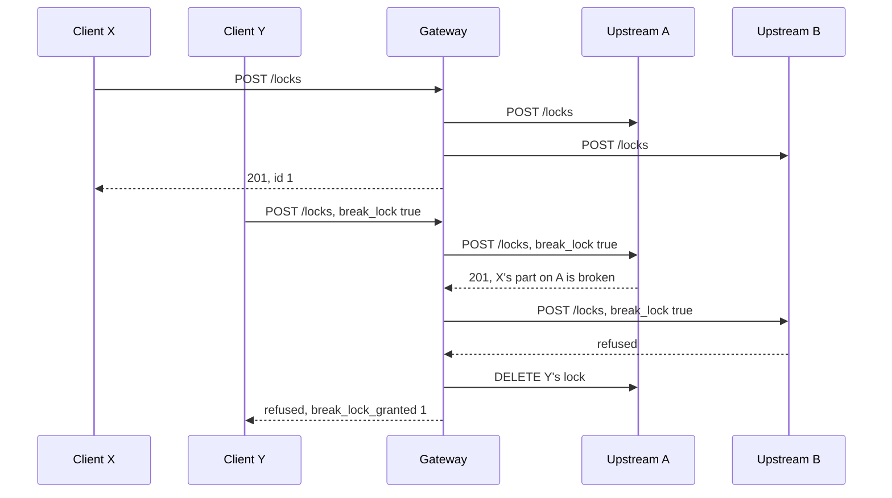

<!--
SPDX-FileCopyrightText: Copyright (c) 2026 Contributors to the Eclipse Foundation
SPDX-License-Identifier: Apache-2.0

AI Disclosure: This document was created with the assistance of Claude Code.
Assisted-by: Claude Code
-->

# Vehicle locks across upstreams

This document is for developers of SOVD clients that lock the vehicle through the gateway. It describes how a vehicle lock behaves when the gateway forwards to several upstreams, and the one limit of it that cannot be solved: a `break_lock` that some upstreams grant and others refuse. The examples use `{base_uri}` for the gateway's API, such as `http://gateway/sovd/v1`.

A client reaches the vehicle through the gateway alone. It cannot reach an upstream, which may be a classic diagnostic adapter (CDA) or any other SOVD server, so everything a client needs to learn or recover goes through the gateway's answers and ids.

## A vehicle lock is one lock per upstream

A lock at the root applies to everything the server manages (ISO 17978-3 7.17.2), so the gateway's lock holds on all upstreams. `POST {base_uri}/locks` acquires a lock from each upstream, in the configured order, and answers with one id of the gateway. If an upstream refuses, the locks acquired so far are released, and the refusal is the answer.

The id names the locks of the upstreams it consists of, its parts. The gateway keeps no state about locks:

- a lock outlives a restart of the gateway, and its id stays valid as long as its parts exist;
- `POST` again by the owner renews every part and answers `200` with the same id;
- an id the gateway did not hand out answers `404`, without reaching any upstream.

The upstreams decide who owns a lock, by the client's token, which the gateway passes on. Every upstream therefore has to accept the same token and see the same `sub`.

`GET {base_uri}/locks` lists what the upstreams list to the client:

- the parts the client owns on all upstreams, once, as its lock;
- every other lock of an upstream, such as one acquired from it directly or one of another client, as a lock of a single part, with an id of the gateway that reaches only that upstream.

Every id in the list can be asked for with `GET`, `PUT` and `DELETE`, and its upstream decides whether the client may.

## Why `break_lock` can break a lock partly

`break_lock` (ISO 17978-3 Table 240) asks a server to break the lock of another client and give the lock to the requester. ISO 17978-3 has no way to ask a server whether it would grant that, and no way to prepare a lock and commit it later: locks have only `POST`, `GET`, `PUT` and `DELETE` (7.17.2 to 7.17.6). Each upstream decides on `break_lock` as it acquires, and a lock it broke cannot be restored. A CDA, for instance, has reset the ECU sessions and the security access of the lock it broke.

So when upstreams decide differently, the gateway cannot undo what the first ones did:



Afterwards:

- X's part on A is broken for good, and X's lock no longer holds on the whole vehicle;
- nobody holds A: Y's lock there is released, as Y did not get the vehicle;
- X still holds B;
- Y holds nothing.

This cannot be prevented by the gateway, and retrying does not help: an upstream that refused refuses again while the situation is the same. What the gateway does is to tell both clients, so that each can recover.

Upstreams that decide alike rarely break a lock partly: give every upstream the same lock policy, and the same token to all of them, which the gateway requires anyway. An upstream that cannot be reached, or fails, can still refuse after others broke their parts.

## What the client that asked to break learns

The refusal keeps the status and the error of the upstream that refused, with a message of the gateway. If upstreams before it granted `break_lock`, `parameters` (ISO 17978-3 Table 16) holds `break_lock_granted`, the number of them. Each of these may have broken a lock, and the gateway does not know whether they did, as an upstream that had no lock to break grants the same way. A CDA refuses a break by its lock policy with `423`:

```http
POST {base_uri}/locks
Authorization: Bearer <token of Y>

{"lock_expiration": 600, "break_lock": true}
```

```http
HTTP/1.1 423 Locked

{
  "error_code": "vendor-specific",
  "vendor_code": "lock-priority-denied",
  "message": "An upstream refused the lock",
  "parameters": {
    "break_lock_granted": 1
  }
}
```

A server that follows ISO 17978-3 Table 241 refuses with `409` instead. Without `break_lock_granted`, nothing was broken: the first upstream refused, or the request did not ask to break.

Y has nothing to clean up. It gets the vehicle by `POST` without `break_lock` once the lock of X is gone, after X released it or after it expired. When that is, the gateway cannot tell, so the answer has no `Retry-After`.

## What the client whose lock was broken learns

X learns it the next time it uses its lock. The broken part answers for itself, as the upstream keeps it until X deletes it, which a CDA does with its defunct lock.

The details show who broke it:

```http
GET {base_uri}/locks/{id}
```

```http
HTTP/1.1 200 OK

{
  "lock_expiration": "2030-01-01T00:10:00Z",
  "owned": true,
  "x-sovd2uds-broken-by": "priority-app"
}
```

A change of the expiration fails with `lock-broken` (ISO 17978-3 Table 18), with what the upstream tells about who broke it:

```http
PUT {base_uri}/locks/{id}

{"lock_expiration": 600}
```

```http
HTTP/1.1 409 Conflict

{
  "error_code": "lock-broken",
  "message": "An upstream reports the lock {id} as broken",
  "parameters": {
    "broken_by": "priority-app"
  }
}
```

`GET {base_uri}/locks` lists the lock with the same `x-sovd2uds-broken-by`. A request that needs the lock on an entity of A fails with A's own `lock-broken`, while a request on an entity of B still succeeds, as X still holds its part there: the gateway enforces no locks itself.

To recover, X deletes its lock, which removes the broken part and releases the parts that still hold:

```http
DELETE {base_uri}/locks/{id}
```

```http
HTTP/1.1 200 OK
```

Then X acquires a new lock, if it still needs the vehicle, and sets up again what the broken part lost, such as ECU sessions and security access.

An upstream that removes a broken lock instead of keeping it answers `404` for that part. The gateway treats that as a lost part: the details and a change of the expiration answer `409` with `lock-broken`. Reading the lock or changing it releases nothing, so the parts that still hold stay with X until its `DELETE` releases them; after that the id answers `404`.

## What the gateway does not do

- It enforces no locks: the upstreams protect what they serve, while what the gateway answers itself, its own entities and `/updates`, stays open to other clients during a vehicle lock.
- It stores no tokens and has no identity of its own, so it releases a part only on a request of a client, with the client's token. A part nobody asks for expires by itself.
- It cannot ask an upstream whether a `break_lock` would be granted, as ISO 17978-3 has no such request.
